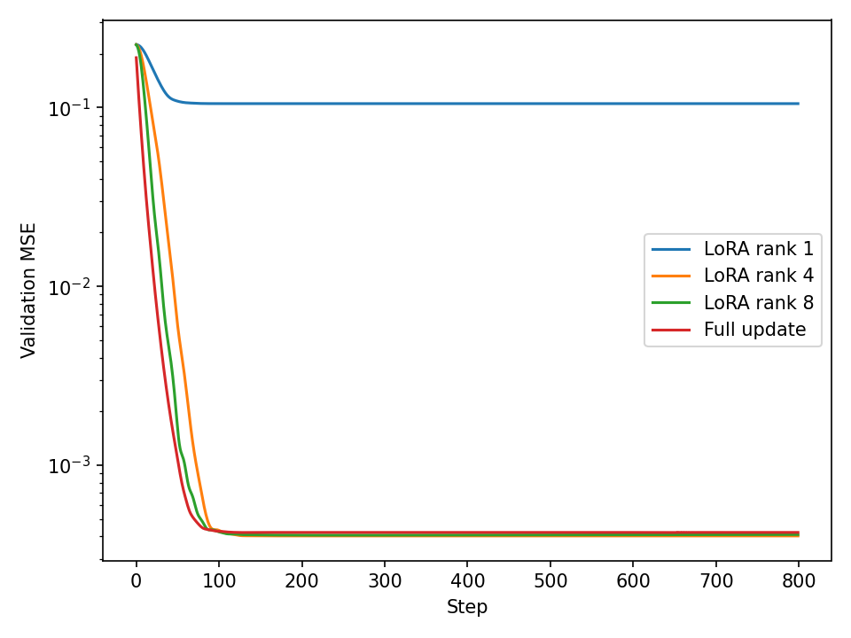
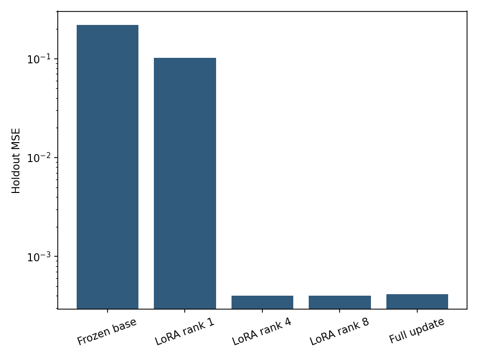

# LoRA Adapter Lab

Train and merge low-rank adapters from scratch with explicit gradients, frozen weights, and held-out evaluation.

---

## Overview

* **Task:** Parameter-efficient adaptation of a frozen linear map.
* **Dataset:** 900 synthetic examples: 600 training, 150 validation, 150 holdout; 32 inputs and 24 outputs.
* **Design:** Known rank-4 target update plus Gaussian observation noise; seed 42.
* **NCA-GENL connection:** Fine-tuning fundamentals, model comparison, gradient debugging, and experimentation.

---

## Key Results

| Method | Trainable parameters | Validation MSE | Holdout MSE |
| :--- | ---: | ---: | ---: |
| Frozen base | 0 | Not selected | 0.220368 |
| LoRA rank 1 | 56 | 0.105220 | 0.102496 |
| LoRA rank 4 | 224 | 0.000403 | 0.000400 |
| LoRA rank 8 | 448 | 0.000407 | 0.000403 |
| Full update | 768 | 0.000421 | 0.000417 |

Rank 4 used 224 parameters versus 768 for the full update, a 70.8% reduction. Rank 1 underfit the known rank-4 update. Rank 8 supplied extra capacity without a meaningful holdout improvement. The fixture deliberately favors a low-rank solution; it does not demonstrate that rank 4 is optimal for an LLM.

## Design

The prediction is `X @ (W + (alpha/rank) * A @ B)`. The base matrix is copied and made read-only. A begins as small random values; B begins at zero, preserving the base output. Explicit gradients update only A and B. A finite-difference test checks both derivatives, including nonzero B so both gradient paths are exercised.

Adam uses learning rate 0.01, 800 steps, and the minimum validation-loss checkpoint for each method. The full-update control uses the same optimizer, split, and training budget. Holdout examples never participate in gradients or checkpoint selection. There is no hyperparameter or seed search.

`Adapter(weight, rank, alpha)` exposes prediction, loss/gradients, adapter-only save/load, and merge. Adapter files require the exact compatible base matrix; they are not standalone models. The included `base.npy` and rank-4 `adapter.npz` form a matching pair.

## Visualizations

| Validation learning curves | Holdout error |
| :---: | :---: |
|  |  |

## Repository Structure

* `adapter.py`: low-rank layer, explicit derivatives, merge and persistence.
* `study.py`: controlled transfer experiment and charts.
* `test_adapter.py`: six tests for gradients, frozen weights, initial equivalence, merge, persistence, and rejected ranks.
* `adapter.npz`, `base.npy`: selected rank-4 checkpoint and frozen base.
* `holdout_inputs.npy`: inputs for prediction checks.
* `metrics.json`, `audit.json`: scores and execution evidence.

## Limits and Sources

This is a synthetic linear transfer experiment, not a pretrained or instruction-tuned LLM. It does not measure catastrophic forgetting, language quality, GPU memory, or wall-clock acceleration. The target has known rank 4 by construction, and the noise standard deviation is 0.02. A single validation split replaces cross-validation for checkpoint selection; uncertainty across seeds was not measured.

Sources: [LoRA paper](https://arxiv.org/abs/2106.09685), [NCA-GENL topics](https://www.nvidia.com/en-us/learn/certification/generative-ai-llm-associate/).
