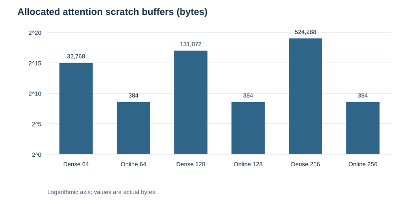
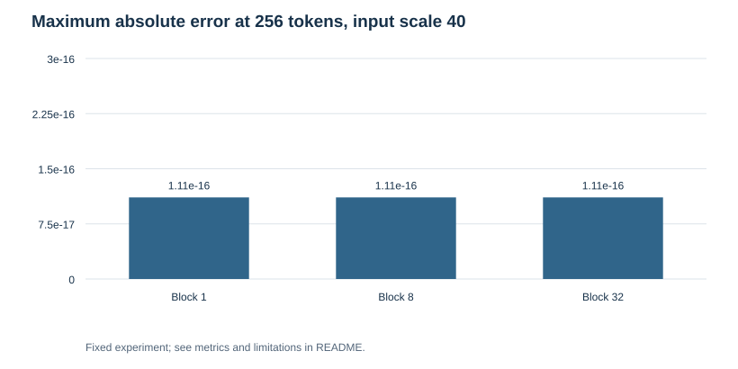

# Online Softmax Attention

Compute exact causal attention one key block at a time, and verify how numerical accuracy and allocated scratch storage compare with a dense score matrix.

---

## Overview

* **Task:** Transformer attention implementation and numerical validation.
* **Inputs:** Deterministic synthetic Q/K/V arrays; 64, 128, or 256 tokens; query/key width 32; value width 16.
* **Comparison:** Dense stable softmax versus online blocks of 1, 8, and 32 keys, at input scales 1 and 40.
* **Main result:** Maximum absolute output difference across all 18 configurations was **2.776e-16**.
* **Scope:** CPU JavaScript reference calculations. No trained language model or GPU kernel.

---

## Key Results

### Allocated Numeric Scratch Buffers

| Tokens | Dense score matrix | Online, block 32 | Reduction |
| :--- | ---: | ---: | ---: |
| 64 | 32,768 bytes | 384 bytes | 85.3× |
| 128 | 131,072 bytes | 384 bytes | 341.3× |
| 256 | 524,288 bytes | 384 bytes | 1,365.3× |

These are the byte lengths of the actual scratch arrays allocated by the implementations. They exclude input arrays, output arrays, JavaScript object overhead, validation allocations, and total process memory. The online algorithm still performs quadratic attention work. Smaller scratch storage does not establish faster execution.

### Numerical Stress Check: 256 Tokens, Input Scale 40

| Block size | Maximum absolute error |
| :--- | ---: |
| 1 | 1.1102e-16 |
| 8 | 1.1102e-16 |
| 32 | 1.1102e-16 |

Scale 40 produces large logits that would make naive exponentiation overflow. Both implementations subtract a running maximum before exponentiation. Inputs are finite, but arbitrarily huge values that overflow the dot product are outside the supported numerical range.

---

## Design

For each query, maintain a running score maximum, a denominator, and a weighted-value numerator. When a later block raises the maximum, rescale the old denominator and numerator before adding the new block. Dividing at the end recovers the same attention result up to floating-point rounding.

The causal path excludes keys after the query position. Noncausal attention is also supported. Inputs use flat Float64Array-compatible arrays; core.js exports dense and online functions. The block size changes the scratch buffer, not the mathematical attention definition.

This is the online-softmax principle used in memory-efficient attention. It does **not** implement FlashAttention's GPU tiling, IO scheduling, backward pass, or CUDA kernels.

---

## Visualizations

| Numeric scratch storage | Output error |
| :---: | :---: |
|  |  |

---

## Validation and Failure Analysis

Eight tests check three block sizes, ragged final blocks, high-magnitude scores, future-value isolation under causal masking, noncausal equivalence, a single-token identity, and rejection of nonfinite inputs. All passed in the available V8 runtime. The high-scale check shows numerical stability for this fixture, not a universal floating-point guarantee.

Cross-validation, dummy classifiers, and holdout accuracy do not apply to this numerical-equivalence study. Runtime timings and total heap usage were deliberately not estimated.

## Repository Structure

* core.js — reusable dense and online attention.
* study.js — seeded fixture and 18 executed configurations.
* test.js — eight correctness checks.
* metrics.json — complete measured errors and numeric buffer sizes.
* figures/ — two charts drawn from the recorded measurements.
* audit.json — runtime, test evidence, and execution limits.
* repository.json — standalone name, description, and topics.
* USAGE.md — command-line usage.

## Sources

* [FlashAttention, official implementation and paper references](https://github.com/Dao-AILab/flash-attention).
* [Online normalizer calculation for softmax](https://arxiv.org/abs/1805.02867).

Original reference implementation for Saud Alotaibi's AI engineering portfolio. No NVIDIA endorsement is implied.
