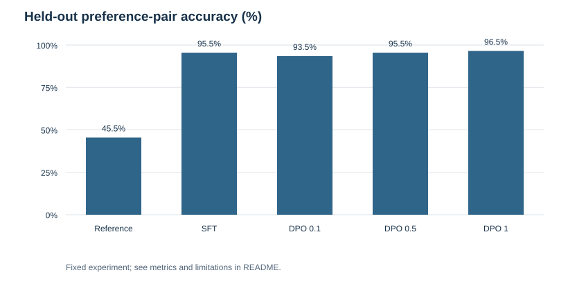
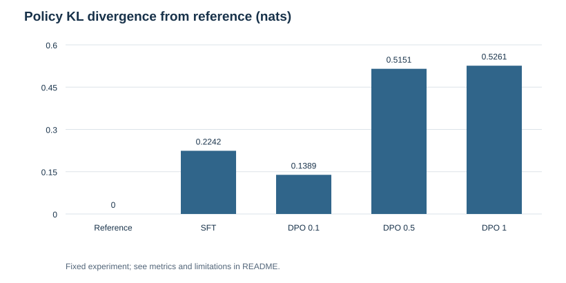

# Preference Loss Lab

Implement Direct Preference Optimization from scratch and compare preference accuracy with supervised training and a frozen reference policy.

---

## Overview

* **Task:** Controlled preference learning and gradient verification.
* **Dataset:** Synthetic six-feature contexts and three candidate actions, labeled by a fixed linear utility oracle.
* **Partitions:** 600 training pairs, 200 validation pairs, and 200 held-out pairs.
* **Controls:** Frozen reference, supervised chosen-action cross-entropy, and DPO at beta 0.1, 0.5, and 1.
* **Scope:** A small contextual policy, **not** a fine-tuned language model or a human-preference benchmark.

---

## Key Results

### Final Holdout Evaluation: 200 Preference Pairs

| Method | Correct pair ordering | Errors | Mean KL from reference |
| :--- | ---: | ---: | ---: |
| Frozen reference | 45.5% | 109 | 0.0000 |
| SFT | 95.5% | 9 | 0.2242 |
| DPO beta 0.1 | 93.5% | 13 | 0.1389 |
| DPO beta 0.5 | 95.5% | 9 | 0.5151 |
| DPO beta 1 | 96.5% | 7 | 0.5261 |

DPO beta 1 had the highest observed pair accuracy in this run, but it is not declared a universally selected winner. DPO beta 0.5 and SFT both made nine ordering errors; DPO beta 0.5 moved farther from the reference distribution. A preference score alone misses that drift.

Validation chooses the checkpoint **within each method**, using that method's own objective. SFT selected step 222; every DPO run selected the final step 400. The DPO runs therefore have not demonstrated convergence. Loss values across different beta settings or SFT are not directly comparable.

---

## Data and Method

Fixed generator seeds are 41 for training, 42 for validation, and 43 for holdout. No seed was selected based on performance. For each context, two different actions are sampled and the fixed utility oracle labels the preferred action. Labels are deterministic and noiseless, which makes this task substantially simpler than human preferences.

The policy maps six features to three logits. DPO uses the policy's chosen-minus-rejected log-probability difference relative to a frozen reference. The softmax normalizer cancels in this difference; core.js evaluates it directly from logits. Stable sigmoid and softplus functions avoid unnecessary overflow.

All trainable comparisons use full-batch SGD, learning rate 0.2, and 400 steps from the same reference weights. SFT optimizes the chosen action's likelihood. DPO optimizes preference pairs. Holdout observations never contribute to gradients or checkpoint selection. KL is computed across the complete three-action distributions on the held-out contexts.

---

## Visualizations

| Preference-pair accuracy | Policy drift |
| :---: | :---: |
|  |  |

---

## Validation and Error Analysis

Eight checks cover the reference-policy loss of log(2), finite-difference gradients for every trainable weight, loss reduction after one step, invariance to a shared logit shift, normalized extreme-logit probabilities, zero reference KL, invalid beta rejection, and deterministic fixtures. All passed.

The reference made 109 ordering errors, compared with seven for DPO beta 1. All per-pair margins are retained in error-analysis.json, including failures. These are descriptive single-run results; no confidence interval or real-world alignment gain is claimed. Wider beta sweeps, noisy labels, sequence likelihoods, and safety judgments are outside this experiment.

## Repository Structure

* core.js — DPO/SFT losses, gradients, normalized policies, and evaluation.
* study.js — deterministic data and controlled training.
* test.js — eight tests.
* metrics.json — method comparisons and checkpoint steps.
* learning-curves.json — validation histories.
* policies.json — reference and trained policy weights.
* holdout-preferences.json — all held-out contexts and labels.
* error-analysis.json — per-pair margins and correctness.
* figures/, audit.json, repository.json, USAGE.md — charts, evidence, metadata, and usage.

## Sources

* [Direct Preference Optimization paper](https://arxiv.org/abs/2305.18290).
* [Original DPO implementation: preference loss](https://github.com/eric-mitchell/direct-preference-optimization/blob/main/trainers.py).

This implementation isolates the preference objective so its gradients and tradeoffs can be inspected before using a full LLM training framework.
