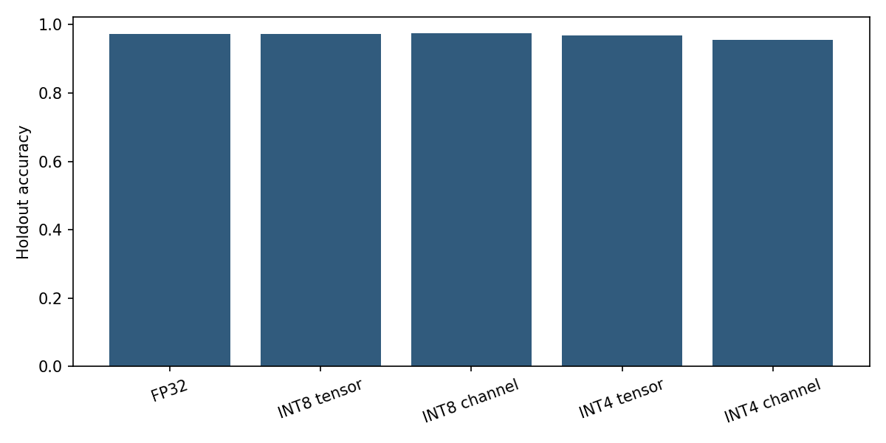
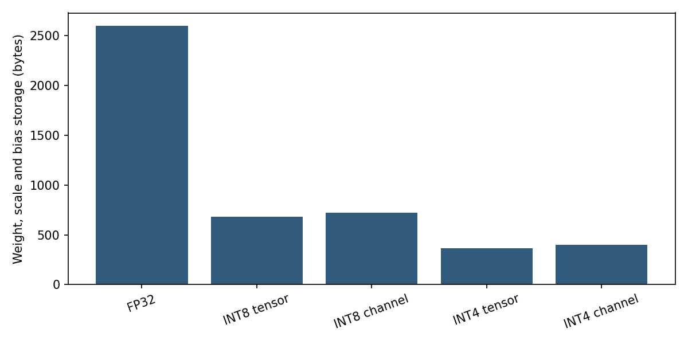

# تدقيق تكميم الأوزان

مقارنة تخزين الأوزان بأربعة أو ثمانية بتات، مع قياس تغير التنبؤات والخسارة وحجم المعاملات.

استخدمت التجربة 1,797 صورة رقمية صغيرة و64 خاصية وعشر فئات. دُرب الانحدار اللوجستي على 1,437 عينة، مع 360 عينة اختبار محفوظة. ملاءمة التقييس تمت على التدريب فقط.

حُفظت أوزان الأربع بتات فعليًا بقيمتين داخل البايت. تشمل أحجام الجدول الأوزان ومقاييس التكميم والانحيازات، ولا تشمل التقييس أو حاوية الملف أو كامل التطبيق.

حافظ التكميم بثمانية بتات ومقياس موحد على تنبؤات المرجع كلها. خفض مقياس القنوات خطأ الدرجات في حالة الأربع بتات لكنه لم يحسن دقة التصنيف؛ انحراف الدرجات والدقة مقياسان مختلفان.

يفك التنفيذ التكميم قبل ضرب المصفوفات بالفاصلة العائمة، فلا توجد نواة ضرب صحيحة أو دعوى تسارع رسومي. لا تمثل النتيجة حيرة نموذج لغوي أو قدرته على الإجابة.

## النتائج المسجّلة

الأرقام التالية من التنفيذ المحفوظ لهذه النسخة؛ لم تُعَد التجارب أثناء تعريب التوثيق.

### التقييم النهائي على الاختبار المحفوظ (360 عينة)

| تمثيل الأوزان | الدقة | الخسارة اللوغاريتمية | حجم المعاملات بالبايت | تغيرات التنبؤ مقارنةً بـ FP32 |
| :--- | ---: | ---: | ---: | ---: |
| FP32 | 0.9722 | 0.1020 | 2600 | 0 |
| INT8 بمقياس واحد للموتر | 0.9722 | 0.1023 | 684 | 0 |
| INT8 بمقياس لكل قناة | 0.9750 | 0.1035 | 720 | 1 |
| INT4 بمقياس واحد للموتر | 0.9694 | 0.0919 | 364 | 6 |
| INT4 بمقياس لكل قناة | 0.9556 | 0.1195 | 400 | 6 |

## الرسوم والنتائج المرئية

الرسوم محفوظة من التنفيذ الأصلي. تعريب هذه الصفحة لا يغيّر بياناتها أو تسميات الصور داخل الملفات.

## الملفات المرجعية

- [مقاييس التقييم والنتائج](metrics.json).
- [بيانات التدقيق وبيئة التنفيذ](audit.json).
- [سجل أخطاء الاختبار](error_analysis.csv).

## المصادر والإسناد

- [مصدر 1: digits dataset](https://scikit-learn.org/stable/modules/generated/sklearn.datasets.load_digits.html).
- [مصدر 2: UCI Optical Recognition of Handwritten Digits](https://archive.ics.uci.edu/dataset/80/optical+recognition+of+handwritten+digits).
- [مصدر 3: NVIDIA quantization documentation](https://nvidia.github.io/TensorRT-LLM/latest/features/quantization.html).
- [مصدر 4: NCA-GENL topics](https://www.nvidia.com/en-us/learn/certification/generative-ai-llm-associate/).

[المرجع التقني الإنجليزي الكامل](README.en.md) يحفظ تفاصيل النسخة الأصلية. تُترك أسماء الملفات والأوامر ومعرّفات النماذج والمقاييس بصيغتها التقنية لضمان تطابقها مع الكود.
