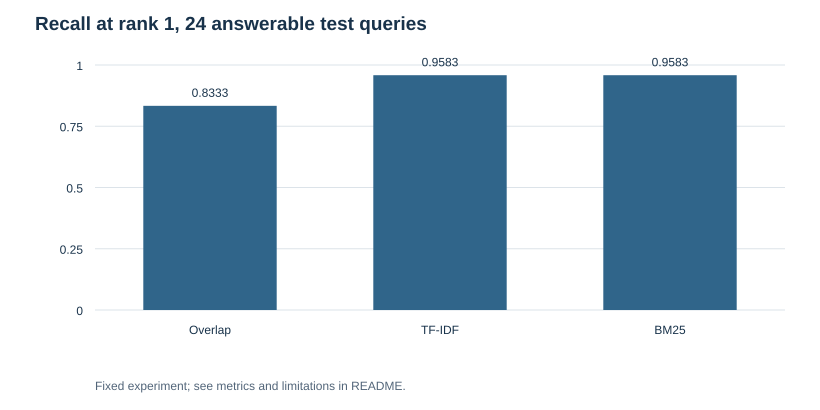
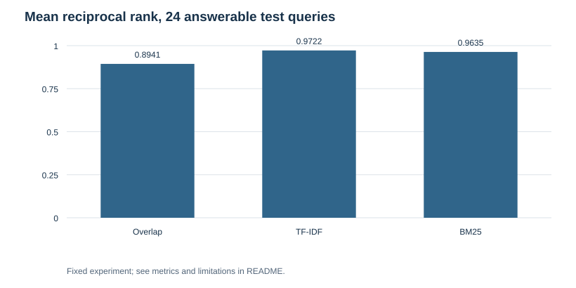

# RAG Retrieval Audit

Compare lexical retrievers on Saud Alotaibi's engineering documentation, retaining relevance labels, abstentions, and failed queries.

---

## Overview

* **Task:** Candidate-document retrieval for a RAG pipeline.
* **Corpus:** Eight actual public project README snapshots, with original URLs and Git blob SHAs.
* **Evaluation:** 12 validation queries and 28 test queries; 24 test queries have one relevant document and four are outside the corpus.
* **Methods:** Unique-token overlap baseline, TF-IDF cosine similarity, and BM25.
* **Scope:** Whole-document lexical retrieval. No embedding model, answer generator, or factuality judge.

---

## Key Results

### Answerable Test Queries: 24

| Method | Recall@1 | Recall@3 | Mean reciprocal rank |
| :--- | ---: | ---: | ---: |
| overlap | 0.8333 | 0.9583 | 0.8941 |
| tfidf | 0.9583 | 1.0000 | 0.9722 |
| bm25 | 0.9583 | 0.9583 | 0.9635 |

BM25 and TF-IDF each retrieved the correct project first for 23 of 24 queries. TF-IDF recovered the remaining relevant project by rank 3; BM25 did not. The overlap baseline is sensitive to document length and shared vocabulary.

### Retrieval With Abstention: All 28 Test Queries

| Method | Correct decision | Answerable queries accepted | Outside-corpus queries accepted |
| :--- | ---: | ---: | ---: |
| overlap | 82.14% | 23/24 | 0/4 |
| tfidf | 96.43% | 24/24 | 0/4 |
| bm25 | 96.43% | 24/24 | 0/4 |

A correct answerable decision requires both accepting the query and ranking its relevant document first. A correct outside-corpus decision requires abstaining. Each method's score threshold was selected on the validation queries; the test set did not set the threshold. Four negative test cases are far too few to establish safe production abstention.

---

## Data Summary

corpus.json preserves the fetched README text, source URL, and Git blob SHA for each of eight repositories: RouteCraft, CacheCraft, SpecForge, RouteForge, StreamGate, Shared-Depth, Prompt Injection Guard, and GAN Image Detection.

The queries and relevance labels were written for this study after reading the corpus. Validation and test queries are different strings but cover the same projects. They are **not independent user traffic** or an external benchmark. Familiarity with the documents and lexical overlap can inflate the scores. The corpus's historical benchmark claims are treated as searchable text, not re-executed or independently verified in this study.

## Design

Tokenization applies Unicode normalization, lowercasing, punctuation splitting, and a fixed small stopword list. Document/query counts drive TF-IDF; BM25 uses k1 = 1.2 and b = 0.75. These settings were fixed before evaluation.

Index exposes search(query, method, k), returning document IDs and scores. Ties sort by document ID. The implementation keeps document-level provenance for citation lookup. It does not chunk documents or construct a generated answer. Read returned text as untrusted content if integrating it into a larger LLM application.

Abstention thresholds maximize validation decision correctness. Ties choose the larger threshold. Thresholds are method-specific and cannot be compared as calibrated probabilities.

---

## Visualizations

| First-result recall | Reciprocal rank |
| :---: | :---: |
|  |  |

---

## Error Analysis

All three methods misranked the query **“detect adversarial instruction text before sending to language model”**, returning the GAN image project first. Similar adversarial terminology in a different domain is a concrete lexical-retrieval failure. Adding an embedding retriever or reranker is a hypothesis to test, not a fix demonstrated here.

The overlap baseline additionally confused top-one versus top-two expert projects and depth sharing versus cache head sharing. One correct top-ranked result was rejected by its calibrated threshold. query-results.json preserves every accepted/rejected decision, score, expected ID, and top-three ranking.

Eight tests check the three methods' known matches, empty/unknown queries, duplicate document IDs, tokenization, ranking metrics, and deterministic ties. All passed.

## Repository Structure

* core.js — reusable lexical index and ranking metrics.
* study.js — validation calibration and fixed test evaluation.
* test.js — eight tests.
* corpus.json — actual source snapshots with provenance.
* queries.json — query splits and relevance labels.
* metrics.json — aggregate comparisons.
* query-results.json — all 84 per-method test decisions.
* figures/, audit.json, repository.json, USAGE.md — charts, evidence, metadata, and usage.

## Sources

* corpus.json links each original public repository and records its source blob SHA.
* [Lucene BM25 implementation](https://github.com/apache/lucene/blob/main/lucene/core/src/java/org/apache/lucene/search/similarities/BM25Similarity.java).

The source snapshots remain attributed to their original repositories. The retrieval engine is an independent reference implementation.
