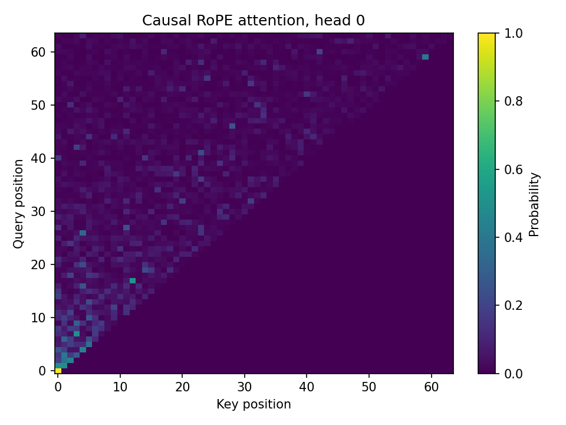
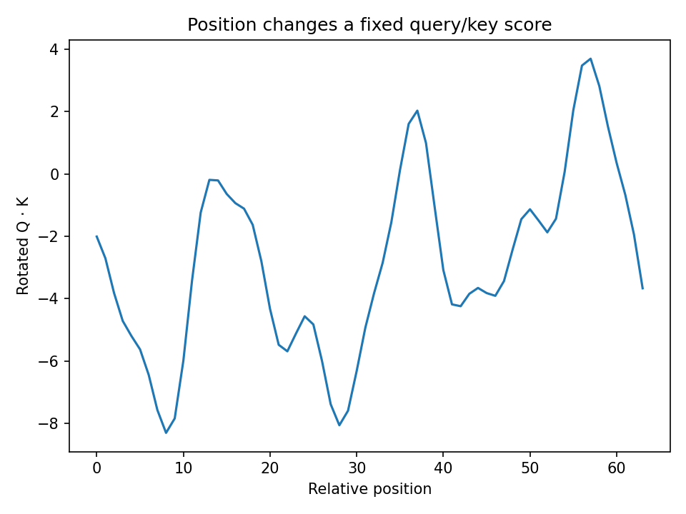

# التضمين الدوراني والانتباه السببي

تنفيذ مرجعي باستخدام NumPy لدوران المواضع والانتباه السببي، مع مقارنة الحساب الكامل بالحساب التدريجي.

تستخدم التجربة موترات عشوائية مضبوطة بالبذرة 42: أربعة رؤوس و64 موضعًا وعرض رأس 32. تقيس الفحوص حفظ معيار المتجه، وعدم تغير النتيجة عند إزاحة المواضع معًا، وتطابق الحساب التدريجي ومنع الانتباه للمستقبل.

اختُبرت ست حالات صحة ورفض للمدخلات. تستخدم الخوارزمية ترتيب الأزواج المتجاورة؛ الأوزان التي تستخدم تقسيم نصف المتجه تحتاج إلى تحويل متوافق.

هذه دراسة تحقق عددي دون تدريب نموذج لغوي أو قياس جودة اللغة. التنفيذ ينشئ مصفوفة الدرجات كاملة، ولا يمثل نواة FlashAttention أو مدير صفحات للذاكرة المخبأة.

## النتائج المسجّلة

الأرقام التالية من التنفيذ المحفوظ لهذه النسخة؛ لم تُعَد التجارب أثناء تعريب التوثيق.

### النتائج الرئيسية

| الفحص | أكبر خطأ مطلق |
| :--- | ---: |
| الانتباه الكامل مقارنةً بالتدريجي | 8.882e-16 |
| إزاحة المواضع معًا بمقدار 137 | 4.108e-15 |
| معيار المتجه بعد الدوران | 8.882e-16 |
| الانتباه المخصص للمفاتيح المستقبلية | 0.0 |

## الرسوم والنتائج المرئية

الرسوم محفوظة من التنفيذ الأصلي. تعريب هذه الصفحة لا يغيّر بياناتها أو تسميات الصور داخل الملفات.

## الملفات المرجعية

- [مقاييس التقييم والنتائج](metrics.json).
- [بيانات التدقيق وبيئة التنفيذ](audit.json).

## المصادر والإسناد

- [مصدر 1: RoFormer paper](https://arxiv.org/abs/2104.09864).
- [مصدر 2: NVIDIA KV-cache documentation](https://docs.nvidia.com/deeplearning/tensorrt/latest/inference-library/transformers-kv-cache.html).
- [مصدر 3: NCA-GENL topics](https://www.nvidia.com/en-us/learn/certification/generative-ai-llm-associate/).

[المرجع التقني الإنجليزي الكامل](README.en.md) يحفظ تفاصيل النسخة الأصلية. تُترك أسماء الملفات والأوامر ومعرّفات النماذج والمقاييس بصيغتها التقنية لضمان تطابقها مع الكود.
